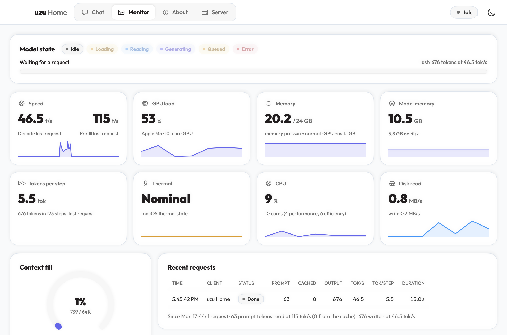
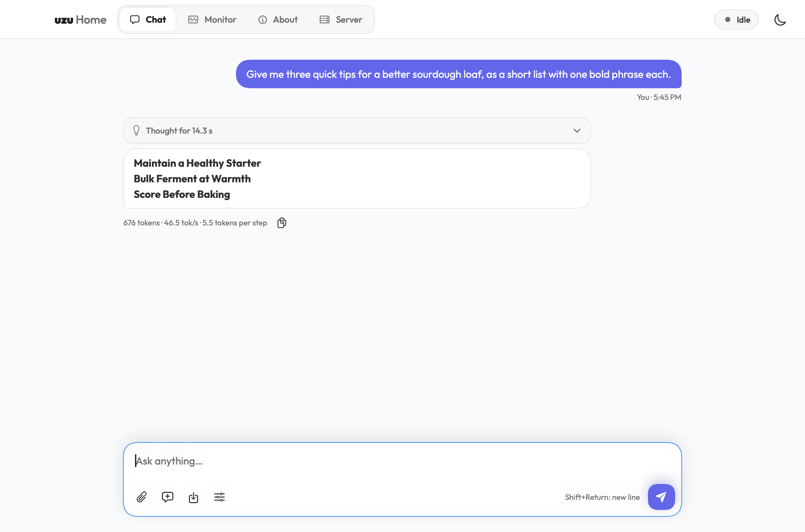
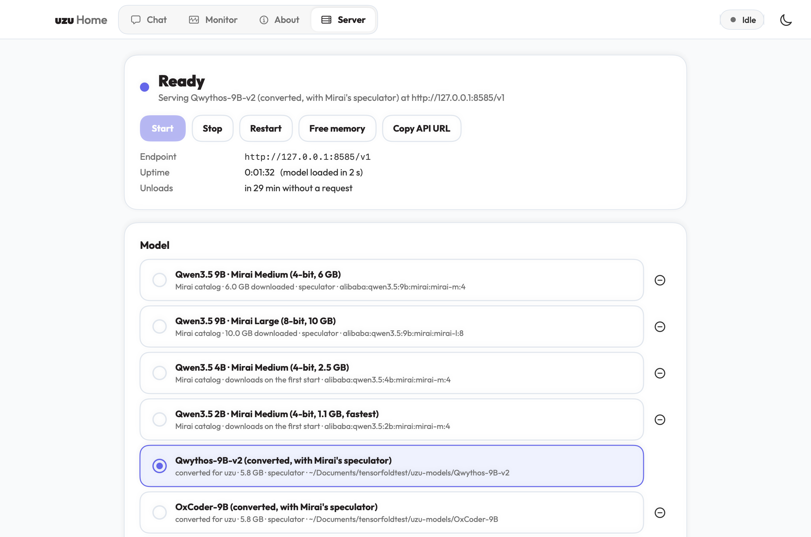

# uzu Home

**An unofficial Mac app for [uzu](https://github.com/trymirai/uzu)**, Mirai's inference engine for Apple silicon. It runs
uzu's model server in the background and keeps one stable endpoint for Hermes and any other OpenAI-compatible app.
It gives you a native window in the style of [StrataHome](https://github.com/majieddd/stratahome) and
[TensorFold Home](https://github.com/majieddd/tensorfoldhome): Chat, a live Monitor, an About page and server
controls, with engine and app updates and a menu-bar item. You don't need a browser or Terminal for any of it.



- **Download:** [UzuHome.zip](https://github.com/majieddd/uzuhome/releases/latest/download/UzuHome.zip) (Apple silicon, macOS 14 or newer)
- **Not affiliated with Mirai**, the makers of uzu. uzu and lalamo are MIT; the models have their own licences.

## What is in the window

| Tab | What it does |
|---|---|
| **Chat** | Streaming answers with Markdown (headings, lists, tables, code blocks with a copy button). A collapsible "Thought for 2.1 s" block shows the model's reasoning. Each answer shows tokens, tok/s and the speculator's tokens per step. You can attach a text file (or drop one), start a New chat with Undo, and save the chat as Markdown. The **Sampling** drawer sets thinking, temperature, top-p, top-k, max tokens and seed, and can share them with other apps. The conversation stays on this Mac. |
| **Monitor** | Live meters, refreshed every second. Model state (idle, loading, reading the prompt, generating, queued, error), decode and prefill speed, GPU load, unified memory and memory pressure, the engine's own memory, **tokens per step**, thermal state, CPU, disk. Below them: context fill, recent requests from every client (Hermes, this app, scripts), the prompt cache, and **performance by uzu version**. |
| **About** | The loaded model (Mirai catalog id or folder, size, speculator) and engine, this Mac's chip, GPU, cores, memory and Metal's GPU memory limit. **Connect your tools** has a copy-ready OpenAI base URL and a ready-made Hermes config. Also the theme, the context length, a second conversation for side requests, and whether the model thinks by default. |
| **Server** | **Start**, **Stop**, **Restart**, **Free memory** and **Copy API URL**. Pick the model, add one **from Mirai's catalog**, or **convert a Qwen3.5 MLX build from Hugging Face**. Choose the memory mode: keep the model loaded, unload it when idle after N minutes, or load it on the first request. **Serve the model on the network** with an optional **API key**. Options, **uzu engine updates**, **uzu Home updates**, and the engine, endpoint, update, conversion and app logs. |

|  |  |
|---|---|
|  |  |

Light and dark themes (or follow macOS) and the Outfit font come from StrataHome; uzu Home's accent is indigo, so it
is easy to tell apart from TensorFold Home. Closing the window keeps the app in the **menu bar**. The cube there shows
the state (filled when the model is loaded, outlined when it is unloaded, see-through when stopped). Its menu has
Start, Stop, Restart, Free memory, the model list, Chat, Monitor and Copy API URL.

## How it fits together

```
 uzu Home (window + menu bar) ─┐
 Hermes / editors / scripts ───┼─► endpoint 127.0.0.1:8585 ──► uzu engine 127.0.0.1:18585
                               │     starts the engine on the      (uzu server, Mirai's engine, with
                               │     first request, unloads it      uzu Home's three patches; ships
                               │     when idle, records stats       inside the app)
```

The **endpoint** is a small gateway that runs from login. It costs almost nothing while the model is unloaded. It
answers `/v1/models` with one model id (`uzu`) and a 64K context, and maps whatever model name a client sends to the
loaded model, so clients keep working when you switch models. It applies the default thinking mode to requests that
don't choose, translates `reasoning_effort` names uzu doesn't know (`none`, `minimal`, `max`), starts the engine when a
generation request arrives, and records every request's tokens, cache reuse, prefill and decode speed, time to first
token and tokens per step for the Monitor. The same controls exist in Terminal as `uzuctl`.

## Connect Hermes and other apps

| | |
|---|---|
| OpenAI base URL | `http://127.0.0.1:8585/v1` |
| Model id | `uzu` (any name is accepted and mapped to the loaded model) |
| API key | none on this Mac; send any value if a client insists |
| Context | 65,536 tokens by default (Hermes needs at least 64,000) |

uzu speaks OpenAI's chat completions only; there is no Anthropic endpoint.

Hermes (`~/.hermes/config.yaml`):

```yaml
model:
  provider: custom
  base_url: http://127.0.0.1:8585/v1
  default: uzu
  context_length: 65536
```

Tested with Hermes Agent 0.21.6 on an M5 with 24 GB: plain answers, terminal tool calls, `reasoning_effort` up to
`xhigh`, and chat titles (JSON-schema output). Hermes's prompt with its tools is about 25,000 tokens. A new
conversation reads all of it once (about 34 s for a 9B model). Its later turns and tool steps reuse it and start
answering in about 0.3 s.

uzu keeps what it has read of the conversation it is in, and a request with a different beginning replaces it. Hermes
asks for a chat title after the first turn, so with one conversation the second turn reads the whole prompt again.
**About > Keep a second conversation** sends such side requests to a second conversation instead, for about 3 GB more
memory at 64K.

## Models

uzu runs models in its own format, not the GGUF files LM Studio uses or plain MLX folders. There are two sources:

- **Mirai's catalog** ([trymirai.com/local-models](https://trymirai.com/local-models)): Mirai's own quantizations, ready
  for uzu, downloaded the first time they start. Medium is 4-bit; Large is 8-bit, slower and closer to the original.
  The 9B builds come with a **speculator**, a small draft model whose guesses the main model checks several at a time.
- **Converted from Hugging Face**: **Server > Add a model > Convert from Hugging Face** (or `uzuctl convert REPO`)
  converts a Qwen3.5 MLX 4- or 8-bit build with [lalamo](https://github.com/trymirai/lalamo), Mirai's converter, set
  up the first time (about 0.7 GB). 9B fine-tunes get Mirai's Qwen3.5-9B speculator; it is trained on the base model
  and carries over well. `uzuctl add-folder PATH` lists a folder you converted yourself.

The default list:

| key | model | size |
|---|---|---:|
| `qwen3.5-9b-m` (default) | Qwen3.5 9B · Mirai Medium (4-bit, speculator) | 6.0 GB |
| `qwen3.5-9b-l` | Qwen3.5 9B · Mirai Large (8-bit, speculator) | 10.0 GB |
| `qwen3.5-4b-m` | Qwen3.5 4B · Mirai Medium (4-bit) | 2.5 GB |
| `qwen3.5-2b-m` | Qwen3.5 2B · Mirai Medium (4-bit) | 1.1 GB |

Converting handles two quirks of community MLX uploads. Some keep `partial_rotary_factor` outside `rope_parameters`,
which lalamo's importer needs inside it. Some (Qwen3.5-9B-The-Defiant-Fable, for one) keep Hugging Face's tensor
layout, with conv1d as `(C, 1, K)` and RMSNorm weights without the `+1` MLX bakes in. mlx-lm fixes that when it loads
them, and lalamo doesn't, so the converter writes the corrected tensors to a small `fixups.safetensors` that lalamo
reads first. A model whose chat template adds an identity line to every system message (Qwythos) can keep it with
`--identity`.

### Measured on an Apple M5 with 24 GB

Single stream, greedy, thinking off, 400-token replies, median of 3. "Edit" asks for a 45-line function back with two
variables renamed, so most of the reply repeats the prompt.

| Model | Engine | Prose | Code | Edit | Prefill |
|---|---|---:|---:|---:|---:|
| Qwen3.5 9B · Mirai Medium (4-bit) | uzu | 31.1 tok/s | 77.6 tok/s | 177.1 tok/s | 705 tok/s |
| Qwen3.5 9B · Mirai Large (8-bit) | uzu | 20.0 tok/s | 50.6 tok/s | 125.7 tok/s | 704 tok/s |
| OxCoder-9B MLX 4-bit, converted | uzu | 32.8 tok/s | 77.2 tok/s | 188.7 tok/s | 776 tok/s |
| Qwythos-9B-v2 MLX 4-bit, converted | uzu | 30.3 tok/s | 73.6 tok/s | 182.2 tok/s | 796 tok/s |
| Qwythos-9B-v2 MLX 4-bit, no speculator | uzu | 25.4 tok/s | 25.6 tok/s | 25.0 tok/s | — |
| Qwythos-9B-v2 MLX 4-bit | TensorFold 0.6 | 24.3 tok/s | 25.1 tok/s | 58.7 tok/s | 802 tok/s |

The speculator speeds up fresh code as well as copy-heavy replies, so uzu with it is 1.2 to 3 times as fast as
TensorFold on the same weights. With it, greedy output can differ slightly in wording between runs (the model checks
several tokens in one step, and the arithmetic of that step differs a little from one token at a time); without it,
output is byte-for-byte repeatable.

Memory, with the speculator: a 9B model takes about 10 GB at 64K context (8.4 GB at 32K), and a second conversation
adds about 3 GB at 64K. uzu sets the context aside up front on GPUs without sparse buffers, the M5 included.

## The engine and its patches

uzu Home ships uzu's CLI (`uzu server`) built from a uzu release with three small patches in `backend/patches`:

| Patch | Why |
|---|---|
| `uzu-server-context-length` | adds `--context-length`. Without it, uzu caps the context at 16,384 tokens on GPUs without sparse buffers (the M5 included), and Hermes needs 64,000. |
| `uzu-grammar-trigger` | makes structured output (`response_format`) work with Qwen-style thinking models. The grammar waits for the end-of-thinking tag, and uzu looked for it as `\n</think>`, which never appears that way once tokenized (`\n\n` is one token), so JSON-schema requests came back as plain text. |
| `uzu-server-sessions` | adds `--sessions N`: several conversations on one loaded model, each request going to the one it continues. |

Mirai's own ready-made CLI is built for macOS 26.4 and has none of these options, so the release builds uzu from
source (`tools/build-engine.sh`). The daily engine check installs a new uzu release from Mirai's build when it runs on
this macOS and has the options, builds it from source with the patches when Rust and Xcode's Metal toolchain are here,
and otherwise waits for the next uzu Home release. A new engine has to start before it is kept; the one it replaced is
kept in `engine/previous` and comes back if it doesn't.

## What else it does

| | |
|---|---|
| **Memory modes** | Keep the model loaded, unload it after N idle minutes (default 30), or load it only on the first request. The endpoint stays up either way. A cached 9B model loads in about 2 s; one that has to come from disk takes longer. |
| **Serving on the network** | Off by default. On, the endpoint listens on `0.0.0.0`, and other computers reach it at the address shown (e.g. `http://192.168.1.15:8585/v1`). **Require an API key** is a second, optional switch: **Generate** writes a random key; other computers send it as `Authorization: Bearer <key>` or `x-api-key`. Requests from this Mac never need it. If macOS asks whether Python may accept incoming connections, allow it. |
| **Shared sampling** | "Use for other apps too" in the Sampling drawer fills those settings into any request that leaves them out, so Hermes gets the same thinking level and temperature. |
| **uzu Home updates** | Checks this repository's releases on startup and every six hours. **Update** downloads `UzuHome.zip` and checks its SHA-256 against the digest GitHub publishes for that asset. A download that doesn't match, or a release with no digest, is refused. The verified app goes in when you quit, and the version you had is kept in `updates/app-before-<version>`. |
| **Performance by uzu version** | Prefill and decode averages per uzu version and model, weighted by tokens, newest first, with the running version compared to the one before. |

## Install

1. Download `UzuHome.zip` from the [latest release](https://github.com/majieddd/uzuhome/releases/latest), unzip it and move **uzu Home** to Applications.
2. The app isn't notarised, so the first time, **right-click it and choose Open**, then Open again. Or check the zip against the SHA-256 in the release notes, or build it yourself (below).
3. Go to **Server > Set up**. It installs the uzu engine that comes with the app, the endpoint, `uzuctl` and the daily engine check; nothing else is needed (converting models later sets up lalamo with [uv](https://docs.astral.sh/uv), which it installs with Homebrew if it isn't there). Then press **Start**; the first start downloads the model (about 6 GB for the 9B Medium).

Requirements: an Apple-silicon Mac with macOS 14 or newer and Python 3.9 or newer (the Command Line Tools' or Homebrew's) for the endpoint. The 9B models were tested on 24 GB; the 2B and 4B need far less.

## Build it yourself

You need the Xcode Command Line Tools (`xcode-select --install`) for the app, and for the engine
[rustup](https://rustup.rs) and Xcode's Metal toolchain (`xcodebuild -downloadComponent MetalToolchain`).

```bash
tools/build-engine.sh   # uzu at the tag in engine/UZU_VERSION, with backend/patches -> engine/uzu
./build.sh
```

This writes `dist/uzu Home.app` and `dist/UzuHome.zip` and prints the zip's SHA-256. `./build.sh dev` builds into
`dist/dev/`, so a running copy is never in the way. `./build.sh --install` also copies the app to `~/Applications`.
`UZU_HOME_NO_ENGINE=1 ./build.sh` builds the app without the engine (CI does). The sources are in `src/`, the backend
scripts it installs are in `backend/`, and `tools/make_icon.swift` draws the icon.

## Check that it works

```bash
"dist/uzu Home.app/Contents/MacOS/UzuHome" --selftest
```

This runs 35 checks: Markdown parsing, version comparison, the SHA-256 gate on an app update, config.env and
models.conf edits, converted-model folders, catalog ids and Hugging Face names, how attachments are fenced, the run
states and the status pill, and this Mac's meters. If an endpoint is running, it also reads its status (it doesn't
send requests). Results go to `~/Library/Application Support/UzuHome/logs/selftest.txt`; exit code 0 means everything
passed.

```bash
python3 -m unittest discover -s tools -p test_gateway.py -v
```

runs 13 tests of the endpoint against a mock of uzu's server on spare ports, with no model and no GPU: `/v1/models`,
"a probe doesn't wake the model", wake on demand and model-name rewriting, chunked JSON and streamed replies, a clear
404 for other APIs, the default thinking mode and `reasoning_effort` names, shared sampling, the per-request stats,
totals, history and per-version performance log, live state and client disconnects, concurrent requests, idle unload
and "keep loaded", and the API key on the network.

`--update-check` runs the real uzu Home release check and writes `logs/update-check.txt`; `--update-download` also
downloads the release's zip and verifies its SHA-256, app identity and version, staging nothing. Other flags:
`--minimized`, `--no-start`, `--tab chat|monitor|about|server`, `--theme light|dark|system`, `--size WxH`, `--probe`,
and for screenshots `--screenshot <png>` with `--delay SECONDS`, `--prompt "text"` and `--drawer`. The images on this
page are made with them.

## Command line

`uzuctl` (linked into `~/.local/bin`) drives the same backend: `uzuctl status`, `uzuctl up`, `uzuctl use oxcoder-9b`,
`uzuctl catalog`, `uzuctl add alibaba:qwen3.5:4b:mirai:mirai-l:8`, `uzuctl convert OWNER/REPO`, `uzuctl mode idle 30`,
`uzuctl context 65536`, `uzuctl sessions 2`, `uzuctl share on`, `uzuctl update`, `uzuctl endpoint`,
`uzuctl logs engine` (`uzuctl help` lists everything). The app and `uzuctl` read and write the same settings.

## Where things are stored

| What | Where |
|---|---|
| App settings, the chat, app logs, update recovery copies | `~/Library/Application Support/UzuHome/` |
| Backend settings (`config.env`), the model list (`models.conf`) | `~/Library/Application Support/UzuHome/backend/` |
| The engine, its version and the previous one | `…/backend/engine/uzu`, `engine/VERSION`, `engine/previous/` |
| Backend scripts, logs, the per-request performance log, the API key | `…/backend/bin`, `logs`, `state/perf/requests.jsonl`, `state/api_key` |
| Converted models, lalamo | `…/backend/models/`, `…/backend/lalamo/` |
| launchd agents | `~/Library/LaunchAgents/io.github.majieddd.uzuhome.gateway.plist`, `.updater.plist`; the engine's in `…/backend/launchd` |
| Mirai catalog models | uzu's cache, `~/.cache/mirai/models` |
| Hugging Face downloads (for conversions) | `~/.cache/huggingface/hub` |

## Known limits

- Apple silicon only.
- Conversions handle Qwen3.5 MLX builds. Other families are in Mirai's catalog or would need a lalamo model spec.
- One request runs at a time; others queue (the Monitor shows them).
- A new conversation reads its whole prompt once; uzu has no saved prompt snapshots.
- Chat is text only: you can attach text files, but not pictures. Not notarised (right-click > Open the first time).

## Licence

MIT, see [LICENSE](LICENSE). The release bundles uzu's CLI (MIT, Mirai Tech Inc.) with uzu Home's patches; the
converter uses lalamo (MIT, Mirai Tech Inc.), installed on first use. The look follows StrataHome (MIT), which follows
Strata's web app (MIT), and the app uses the Outfit font (SIL OFL 1.1). See [NOTICE.md](NOTICE.md).
